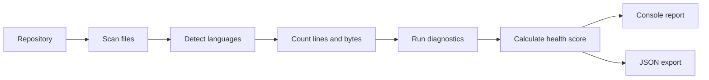

<div align="center">

# 🔍 RepoLens

### A clear and lightweight repository analyzer built with Python

Inspect project structure, measure code statistics, detect unnecessary files, and calculate a repository health score — directly from the command line.

[](https://github.com/linkoro57/RepoLens/actions/workflows/tests.yml)
[](https://github.com/linkoro57/RepoLens)
[](https://www.python.org/downloads/)
[](pyproject.toml)
[](LICENSE)

[Quick start](#-quick-start) · [Analysis pipeline](#-analysis-pipeline) · [Metrics](#-metrics) · [Health score](#-health-score) · [Library API](#-library-api) · [Tests](#-tests)

</div>

> [!IMPORTANT]
> RepoLens is read-only. It analyzes repository contents without modifying, deleting, or reorganizing any inspected file.

## ✨ Highlights

| 📊 Code statistics | 🧠 Language detection | 🩺 Health score |
| :--- | :--- | :--- |
| Count files, lines, and total repository size. | Recognize common programming and data formats automatically. | Convert repository issues into a clear score from 0 to 100. |

| 🧹 Junk detection | 📦 Largest files | 📄 JSON reports |
| :--- | :--- | :--- |
| Find generated, temporary, and unnecessary files. | Identify files responsible for most of the repository size. | Export structured results for scripts, dashboards, and CI. |

## 🚀 Quick start

### 1. Install

```bash
git clone https://github.com/linkoro57/RepoLens.git
cd RepoLens
python -m pip install .
```

### 2. Analyze

```bash
repolens path/to/project
```

Without installation, replace `repolens` with `python repolens.py`.

### 3. Export

```bash
repolens path/to/project --json report.json
```

## 🧱 Analysis pipeline



## 📈 Metrics

| Metric | Description |
| :--- | :--- |
| Files | Number of analyzed files outside ignored directories |
| Lines | Total lines across recognized text formats |
| Size | Combined size of all analyzed files |
| Main language | Language containing the greatest number of lines |
| Largest files | Biggest files sorted by byte size |
| Issues | Missing metadata, generated files, and large assets |

```bash
repolens .
repolens . --largest 20
repolens . --include-hidden
repolens . --json analysis.json
```

## 🩺 Health score

Every project begins at `100`. RepoLens applies explicit penalties when it finds maintainability or repository hygiene problems.

| Check | Penalty |
| :--- | :---: |
| Missing `README.md` | -12 |
| Missing license | -8 |
| Missing `.gitignore` | -6 |
| Generated or temporary file | -2 |
| File larger than 5 MB | -3 |

> [!TIP]
> The score is a quick hygiene indicator, not a measurement of code correctness or security.

## 🐍 Library API

```python
from pathlib import Path
from repolens import RepositoryAnalyzer

report = RepositoryAnalyzer().analyze(Path("my-project"))

print(report.main_language)
print(report.total_lines)
print(report.score)
```

## 🏗️ Project architecture

```text
RepoLens/
├── repolens/
│   ├── core/
│   │   ├── analyzer.py
│   │   ├── diagnostics.py
│   │   ├── languages.py
│   │   ├── metrics.py
│   │   ├── scanner.py
│   │   └── scoring.py
│   ├── models/
│   │   ├── file_info.py
│   │   ├── issue.py
│   │   └── report.py
│   ├── reporting/
│   │   ├── console.py
│   │   └── json_reporter.py
│   ├── cli.py
│   ├── config.py
│   └── constants.py
├── docs/
├── tests/
├── repolens.py
└── pyproject.toml
```

## 🧪 Tests

```bash
python -m unittest discover -s tests -v
```

GitHub Actions tests every push and pull request on Python 3.10, 3.11, 3.12, and 3.13.

## ⚠️ Scope and limitations

- Language detection is based on file extensions.
- Binary files contribute to repository size but not line counts.
- Directories such as `.git`, `node_modules`, virtual environments, and build outputs are ignored by default.
- The health score evaluates repository hygiene, not architecture, security, or runtime behavior.

## 📄 License

Distributed under the [GNU General Public License v3.0](LICENSE).

<div align="center">

**See the structure. Measure the health.**

</div>
